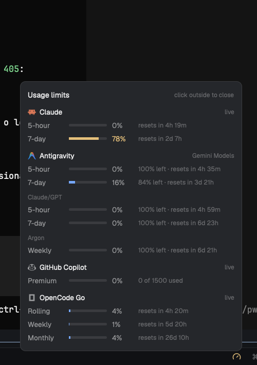

# Herdr Usage Status

One compact usage gauge in Herdr's bottom status bar. Click it for a small panel with every available subscription limit; providers without data are hidden.



## What it shows

- **Claude** — 5-hour and 7-day usage, reset countdowns. Reads Claude Code's OAuth token from the login Keychain.
- **Antigravity** — Gemini 5-hour/weekly, Claude/GPT 5-hour/weekly, and Gemini 4 Argon weekly. Runs the read-only `agy -p "/usage"` command.
- **GitHub Copilot** — premium-request quota, used/entitlement.
- **OpenCode Go** — rolling, weekly, and monthly allowances from the local OpenCode service.
- **Codex** — 5-hour and 7-day windows when `~/.codex/auth.json` has a valid ChatGPT session; otherwise hidden.

The gauge color follows the fullest provider: normal, yellow at 70%+, red at 90%+. Hovering shows a one-line summary; clicking opens the panel with used percentages, bars, `% left`, reset times, and `live` / `cached` / `stale` status. The refresh icon in the panel header spins while any provider is fetching and re-runs every provider when clicked.

## Requirements

- macOS for the Claude Keychain read (`security`). The other providers are optional.
- `python3`.
- Optional: `node` + the `copilot` CLI (GitHub Copilot), `opencode` (OpenCode Go), `agy` (Antigravity), and `~/.codex/auth.json` (Codex).
- A Herdr personal layout that points the `status` block to `usage-status`.

The mod hides any provider that has no data, so missing CLIs do not break the bar.

## Install

Copy/sync `mods/usage-status` into `~/.config/herdr-app/mods/`, then wire the status block in a personal layout clone:

```json
{
  "id": "status",
  "type": "block",
  "content": { "mod": "usage-status" },
  "size": { "px": 28 }
}
```

If your layout is a shipped one, clone it first:

```sh
herdr-app do layout.clone --name main --as my-layout
```

Then:
```sh
herdr-app check ~/.config/herdr-app/mods/usage-status
herdr-app status
```

## Behavior

- Claude polls every 5 minutes; Copilot every 5; Codex every 2; OpenCode every 2; Antigravity every 10. The panel's refresh button starts an out-of-schedule fetch for every provider and spins until they finish; a fetch that hangs is marked failed after 60 seconds.
- Successful results are cached in hidden `.cache-*.json` files. On failure the panel keeps the last known values and labels them `cached` / `stale`.
- Claude rate limits (`429`) are expected; the cache avoids an `offline` bar.
- The Codex helper never refreshes the token: the Codex CLI owns that rotation. Without a valid session, Codex is hidden.
- No credentials or caches are committed. The helpers only read local auth and call the providers.

## Repository

Source of truth for the mod. After edits:

```sh
./sync.sh
```

It copies the mod to the live Herdr folder and runs `herdr-app check`. See `AGENTS.md`.

## Publish

This repo is an app-mod repo. To share it on `herdr.dev/mods`:

- keep `mods/usage-status` at the root;
- keep `RECIPE.md` and `preview.png`;
- add the topic `herdr-mod`;
- make the repository public.

See `.agents/skills/herdr-publish/SKILL.md` and `references/publishing.md` for the full checklist.
