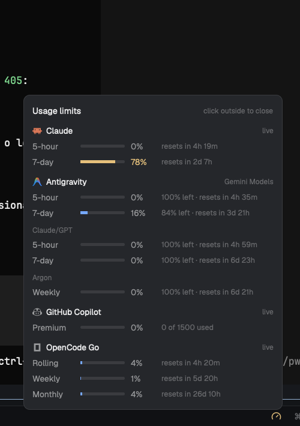

# Usage Status

One compact gauge in Herdr's bottom status bar. Click it for a small panel with every available subscription limit. Providers without data are hidden.

## What you see

The 28 px status bar keeps the machine, branch, agent count, and palette hint. At the right there is one gauge icon instead of a row of meters. The icon is muted normally, yellow at 70%+ usage, red at 90%+. Hover it for a one-line summary; click it for the panel.

The panel shows one line per limit window:

- **Claude** — 5-hour and 7-day bars, used %, reset countdown.
- **Antigravity** — Gemini Models, Claude/GPT, and Argon groups; each row shows used %, `% left`, and reset.
- **GitHub Copilot** — premium requests used / entitlement.
- **OpenCode Go** — rolling, weekly, monthly.
- **Codex** — 5-hour / 7-day when a valid session exists. Hidden otherwise.

Rows use theme colors and the same green/yellow/red thresholds. The panel is compact, one line per window, and scrolls only if a provider adds many windows.

## How it behaves

- Clicking the gauge opens the panel; clicking it again, clicking outside, or Escape closes it.
- The gauge color is the highest used percentage across providers with data.
- Each provider polls on its own schedule: Claude 5 min, Copilot 5 min, Codex 2 min, OpenCode 2 min, Antigravity 10 min.
- Successful results are cached in hidden `.cache-*.json` files. On a failed refresh the panel keeps the last data and labels it `cached` / `stale`; the bar never shows an `offline` provider just because one request failed.
- Claude `429` responses are handled with the cache; the helper retries on the next poll.
- Codex is optional and is hidden when `~/.codex/auth.json` has no valid ChatGPT token. The helper never refreshes credentials.
- A provider with no data is not rendered in the panel at all, so missing CLIs do not add noise.

## Built from

- A clone of the shipped `workspace-status` mod (`mods/usage-status/main.js`) that keeps the existing machine/branch/agents/palette content and adds the gauge.
- `usage.py` — Claude: Keychain token + `https://api.anthropic.com/api/oauth/usage`, cache, 429 handling.
- `antigravity-usage.py` — runs `agy -p "/usage"`, parses tab-separated quota rows, selects Gemini Models as primary and keeps Claude/GPT and Argon as extra groups.
- `copilot-usage.mjs` — starts the Copilot CLI SDK, calls `account.getQuota`, returns the premium-request snapshot.
- `codex-usage.py` — `GET https://chatgpt.com/backend-api/wham/usage` with the local Codex OAuth token, handles current and legacy window shapes, caches, never refreshes the token.
- OpenCode — `opencode api GET /api/experimental/usage/limits`.
- `gauge.svg` and `codex.svg` are the status-bar icon and the Codex glyph.
- `herdr` APIs: `exec`, `appHome`, `theme`, `spaces`, `agents`, `window`, `keys`, `run`; `Popover` from `gpui-base`.
- The personal layout `main-ref.json` points the `status` block at `usage-status`.

## Watch out

- The Claude Keychain read is macOS-specific; on other platforms the Claude section stays hidden until there is a cache.
- Antigravity's `/usage` command takes about 3 seconds; it polls every 10 minutes. Its output can change; the parser handles five-hour/weekly labels and groups.
- Copilot's SDK path is resolved next to the installed `copilot` binary. If Copilot is not installed, the section is hidden.
- The helpers write caches into the mod folder. They are hidden and excluded from git; do not commit them.
- Do not rename the mod folder: `main.js` references `mods/usage-status/...`.
- The panel only shows providers that returned data; Codex will appear by itself once a valid session exists.
- No credentials are stored in the repo; the helpers read local auth at runtime.

## Done when

- `herdr-app check` passes for `mods/usage-status`.
- The gauge appears in the status bar and changes color with the highest usage.
- Clicking the gauge opens the compact panel; Escape/outside closes it.
- Claude, Antigravity, Copilot, and OpenCode rows show the expected values; Codex is hidden without a valid session.
- `herdr-app status` reports no errors.
